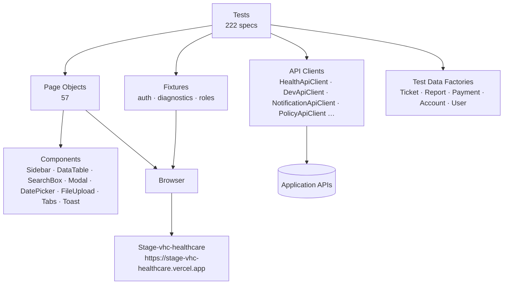

# Architecture

## Layers

1. **Tests** describe business scenarios only — no selectors.
2. **Page objects** own locators and page-level actions/assertions.
3. **Components** are shared UI (Sidebar → 57 page(s), DataTable → 22 page(s), SearchBox → 1 page(s), Modal → 1 page(s), DatePicker → 10 page(s), FileUpload → 2 page(s), Tabs → 9 page(s), Toast → 54 page(s)).
4. **API clients** set up data fast and verify backend state (UI + API + data validation).
5. **Fixtures** provide authenticated pages per role (customerAshaPage) and attach console/network diagnostics.

## Execution model

Parallel by default (balanced profile). Tests share no state, so they can be sharded across workers and machines; results aggregate into one JUnit/JSON report.
